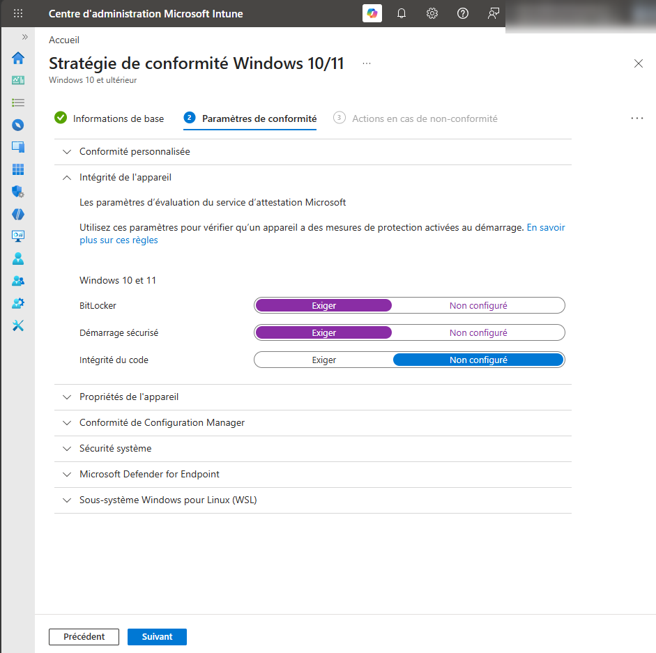
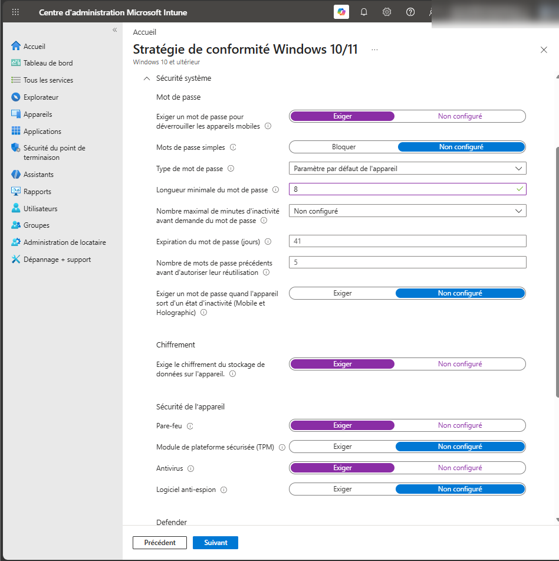
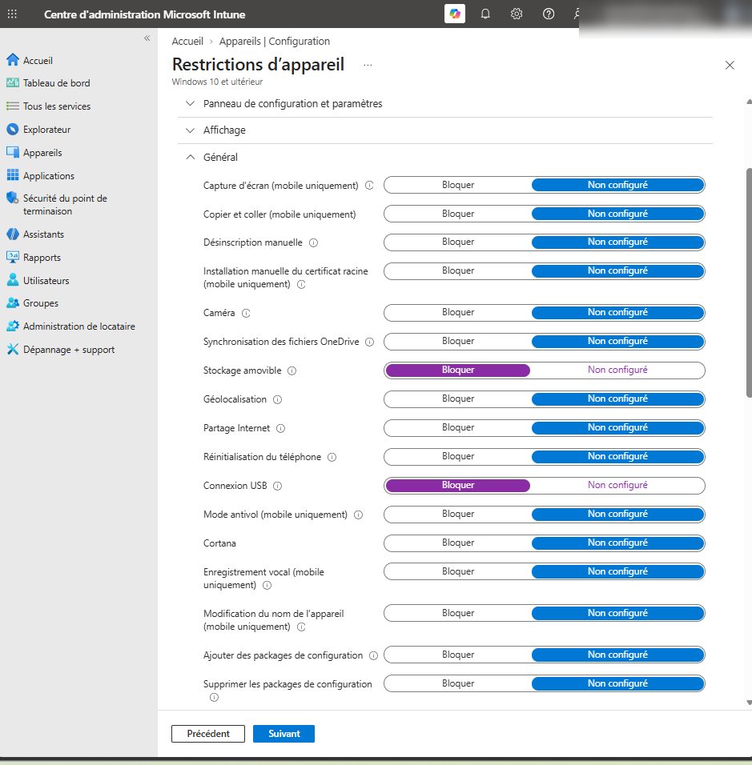
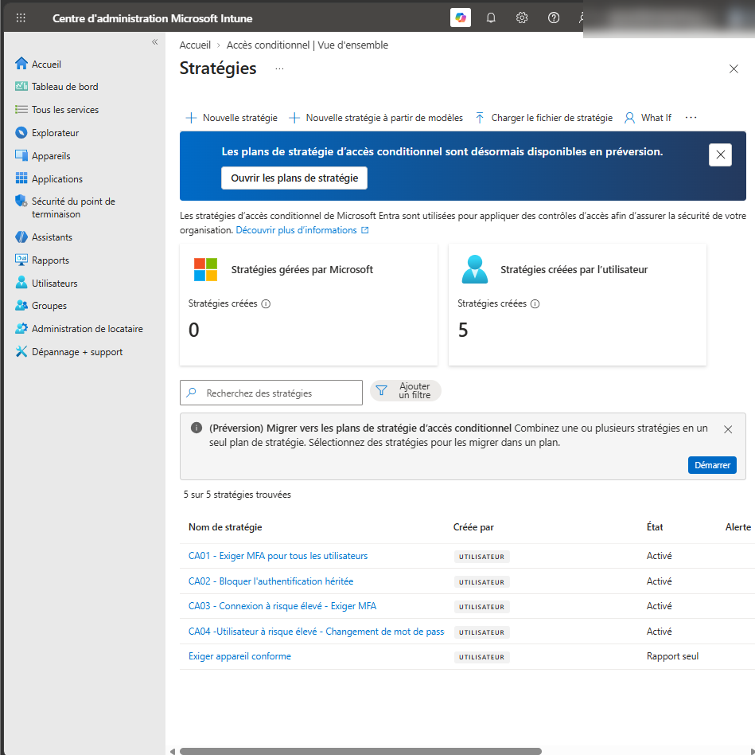
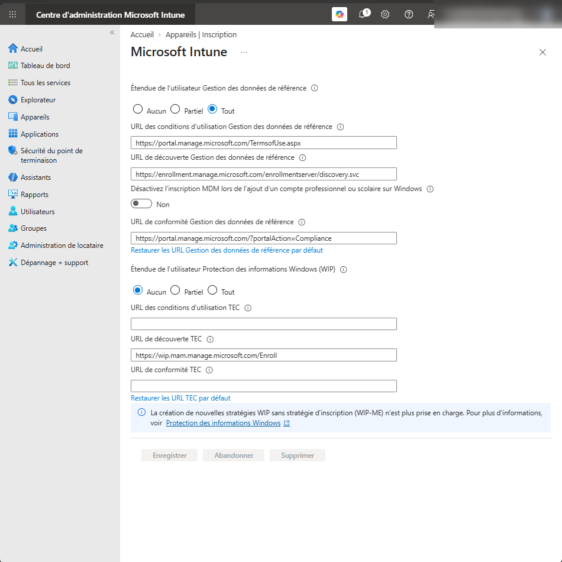
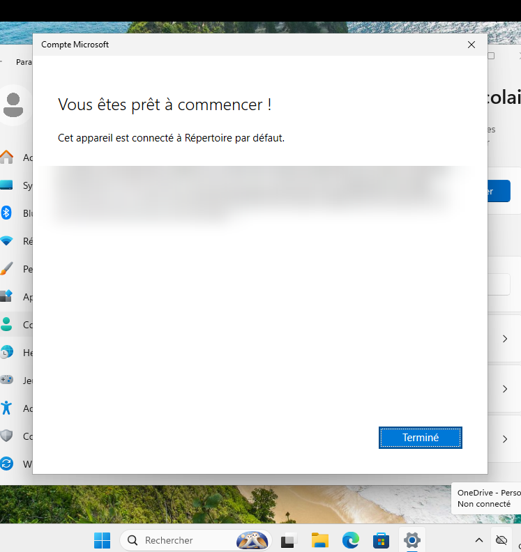
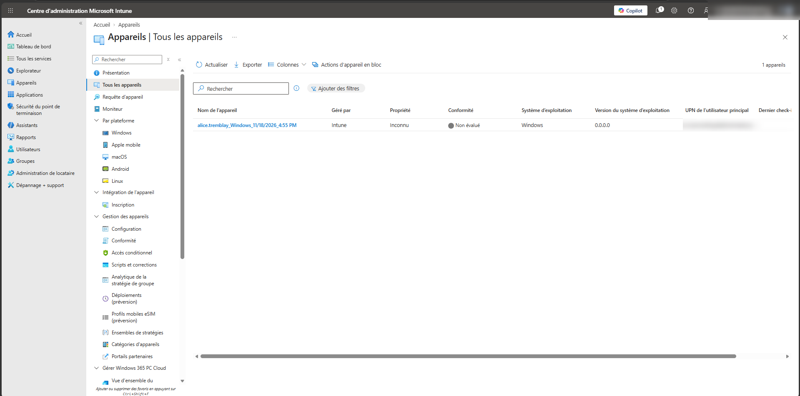
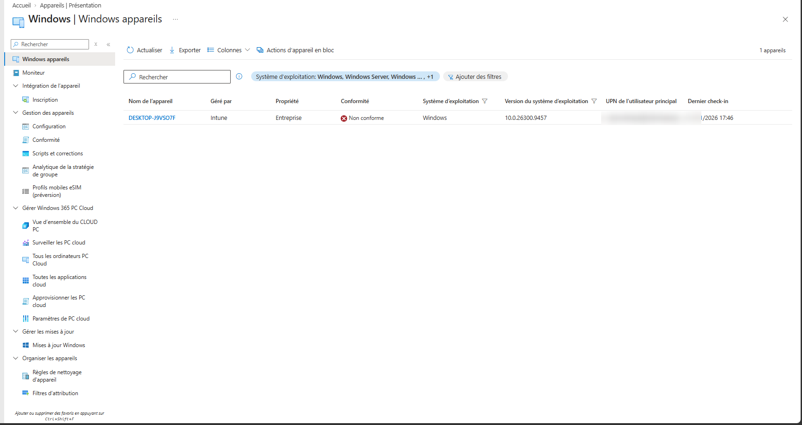
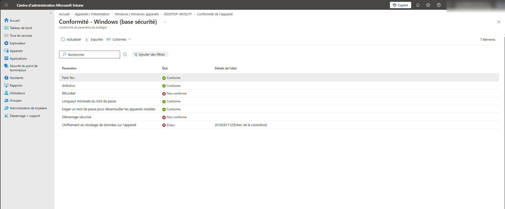

# Lab 07 — Microsoft Intune : gestion et conformité des endpoints (MDM & accès conditionnel)

**English summary:** Hands-on lab on Microsoft Intune, built on my own test tenant (Microsoft Entra ID P2 + a Microsoft Intune Plan 1 trial). The goal: enforce device health and security on managed endpoints, the foundation of a Zero Trust posture. I built a **Windows compliance policy** (BitLocker, password, encryption, firewall, antivirus), a **device configuration profile** that hardens a setting (blocking USB removable storage to prevent data exfiltration), and a **Conditional Access policy** requiring devices to be marked compliant before accessing company resources  which ties this lab directly to my identity lab (Lab 5). I then **enrolled a real test device** (a Windows 11 VM) by Entra-joining it, which auto-enrolled it into Intune, and watched it get evaluated against the compliance policy. The device came back **non-compliant**: it passed the firewall, antivirus and password rules, but failed **BitLocker**, **Secure Boot** attestation and **storage encryption**  so the policy correctly flagged it. This demonstrates the full loop end to end: enroll → evaluate → the policy checks each control and catches the ones that fail → the device is marked non-compliant, which in production is what Conditional Access uses to block access until the device is remediated.

---

## Contexte : la place d'Intune dans la sécurité

Détecter et répondre aux incidents, c'est une chose ; encore faut-il que les **appareils** qui accèdent aux ressources soient sains. C'est le rôle d'Intune : gérer les endpoints, imposer des règles de sécurité, et fournir un signal « conforme / non conforme » qui sert ensuite à **décider de l'accès**.

| | Rôle | Exemples |
|---|---|---|
| **Gestion des endpoints (MDM)** | Gérer et sécuriser les appareils | **Microsoft Intune** (conformité, configuration, inscription) |
| **Décision d'accès** | Autoriser ou bloquer selon le risque | Accès conditionnel (Entra ID) |

> **Le principe clé : Intune évalue la conformité, l'accès conditionnel décide.** Intune dit « cet appareil respecte (ou non) les règles » ; Entra ID utilise ce signal pour accorder ou bloquer l'accès. Ensemble, c'est un pilier du **Zero Trust** : aucun appareil n'accède aux ressources sans avoir prouvé qu'il est sain.

## Environnement

| Élément | Valeur |
|---|---|
| Plateforme | Microsoft Intune (essai Plan 1) + Microsoft Entra ID P2 |
| Appareil de test | VM **Windows 11 Entreprise** (évaluation) sous VMware Workstation |
| Portails | `intune.microsoft.com`, `entra.microsoft.com`, `admin.microsoft.com` |
| Utilisateur de test | un compte de test du tenant (licence Intune assignée) |

---

## Étape 1 — Politique de conformité (définir un appareil « sain »)

J'ai créé une politique de conformité **Windows 10/11** qui fixe les critères minimaux de sécurité :

- **Intégrité de l'appareil** : BitLocker exigé, démarrage sécurisé (Secure Boot) exigé.
- **Sécurité système** : mot de passe exigé (longueur minimale 8), chiffrement du stockage exigé, pare-feu exigé, antivirus exigé.
- **Action en cas de non-conformité** : l'appareil est marqué **non conforme** immédiatement.
- **Affectation** : tous les utilisateurs.

## Étape 2 — Profil de configuration (durcissement)

J'ai ajouté un profil de configuration (modèle **Restrictions d'appareil**) pour imposer un réglage de sécurité concret : **bloquer le stockage USB amovible**.

> **Pourquoi :** bloquer les clés/disques USB empêche la copie non autorisée de données — une mesure classique de **prévention de la perte de données (DLP)** et de protection contre l'exfiltration.

## Étape 3 — Accès conditionnel : exiger un appareil conforme

C'est le lien avec mon [Lab 5 (identités)](../lab05-identites) : j'ai créé une stratégie d'accès conditionnel qui **exige que l'appareil soit marqué conforme** pour accéder aux ressources.

- **Ciblage** : un utilisateur de test, avec le **compte admin exclu** (compte « bris de glace » / break-glass).
- **Contrôle d'octroi** : exiger que l'appareil soit marqué comme conforme.
- **Mode** : **Rapport seul** (report-only) — la stratégie évalue et journalise sans bloquer, pour tester sans risque.

> **Bonne pratique :** on exclut toujours un compte d'urgence des stratégies d'accès conditionnel pour ne jamais risquer de se verrouiller hors du tenant, et on déploie par étapes (rapport seul → pilote → tous).

## Étape 4 — Inscrire un vrai appareil

Pour voir le cycle complet, j'ai inscrit une VM Windows 11 :

1. **Préparer l'auto-inscription** : côté Entra, j'ai mis l'**étendue utilisateur MDM** sur **Tous**, pour qu'un appareil joint à Entra ID s'inscrive automatiquement dans Intune.

2. **Joindre l'appareil à Entra ID** : depuis la VM (Paramètres → Comptes → Accéder professionnel ou scolaire → **Joindre cet appareil à Microsoft Entra ID**), connexion avec l'utilisateur de test.

3. **Inscription automatique** : la jonction a déclenché l'inscription dans Intune. L'appareil apparaît, **géré par Intune**.

## Étape 5 — Résultat : évaluation de la conformité

Une fois la politique appliquée et l'appareil synchronisé, l'évaluation s'est faite **règle par règle**. La VM a été marquée **non conforme** ❌.

Le détail montre précisément ce qui passe et ce qui échoue :

| Règle | Résultat |
|---|---|
| Pare-feu | ✅ Conforme |
| Antivirus | ✅ Conforme |
| Longueur minimale du mot de passe | ✅ Conforme |
| Exiger un mot de passe pour déverrouiller | ✅ Conforme |
| **BitLocker** | ❌ Non conforme |
| **Démarrage sécurisé (Secure Boot)** | ❌ Non conforme |
| **Chiffrement du stockage** | ❌ Erreur (échec de la correction) |

> **C'est la démonstration clé.** La politique n'est pas une boîte noire « conforme / non conforme » : elle évalue **chaque contrôle** et identifie exactement ceux qui échouent (ici le chiffrement et Secure Boot, non activés sur la VM). En production, l'accès conditionnel (étape 3) **bloquerait** l'accès de cet appareil tant que ces points ne sont pas corrigés (activer BitLocker, etc.). Une fois remédié, l'appareil repasserait conforme et l'accès serait rétabli — c'est la boucle complète du Zero Trust appliqué aux appareils.

## Ce que j'ai appris

- **MDM et inscription** : un appareil n'est géré par Intune qu'une fois **inscrit** (joint à Entra ID + inscription MDM). Se connecter à une app de travail ne suffit pas.
- **Conformité** : on définit des règles (chiffrement, mot de passe, Secure Boot…) ; l'appareil est évalué et marqué conforme ou non.
- **Gestion complète (MDM) vs protection d'applications (MAM)** : en MDM, tout l'appareil est géré ; en MAM, seules les données de travail dans les apps le sont (idéal pour le BYOD, sans toucher à la vie privée).
- **Accès conditionnel + conformité** : Intune fournit le signal, Entra ID décide de l'accès — le cœur du Zero Trust.
- **Break-glass et déploiement progressif** : exclure un compte d'urgence, et déployer en rapport seul avant d'activer.

## Lien avec le marché de l'emploi

La gestion des endpoints et de la conformité revient dans beaucoup de postes d'analyste cyber et de sécurité opérationnelle, et recoupe les certifications **MD-102 (Endpoint Administrator)** et **SC-300 (Identity and Access)**. Ce lab complète mes labs de détection (Sentinel/Defender) et d'identité (Entra ID) par le volet **appareils** : ensemble, ils couvrent détecter, gérer les accès **et** garantir des endpoints sains.

## Nettoyage et notes

- L'essai **Intune Plan 1** et la VM d'évaluation sont temporaires (90 jours pour la VM).
- La stratégie d'accès conditionnel est restée en **rapport seul** pour éviter tout blocage.

## Avertissement

Laboratoire personnel réalisé sur mon propre tenant de test et une machine virtuelle d'évaluation, à des fins d'apprentissage. Les identifiants du tenant, les adresses de courriel et les identifiants d'abonnement sont masqués dans les captures. Aucune donnée réelle ni sensible n'est utilisée.
